# Timetable Management System


<h3 align="center">
  Academic Timetable Management & QR Code Attendance System
</h3>

<p align="center">
  A university-oriented web application for managing academic timetables, 
  organizing student information, and automating classroom attendance 
  through QR Code validation.
</p>

<p align="center">
  
  
  
  
  
  
</p>

<p align="center">
  <strong>~2,000 Users</strong> ·
  <strong>Role-Based Access Control</strong> ·
  <strong>QR Code Attendance</strong> ·
  <strong>Excel Data Import</strong>
</p>

---

## Table of Contents

- [Overview](#overview)
- [Project Objectives](#project-objectives)
- [Key Features](#key-features)
    - [Authentication and Access Control](#1-authentication-and-access-control)
    - [Academic Timetable Management](#2-academic-timetable-management)
    - [Student and Teacher Management](#3-student-and-teacher-management)
    - [QR Code Attendance System](#4-qr-code-attendance-system)
    - [Attendance Management](#5-attendance-management)
    - [User Interface](#6-user-interface)
- [Technical Highlights](#technical-highlights)
- [System Architecture](#system-architecture)
- [Technologies](#technologies)
- [Database Design](#database-design)
- [Screenshots](#screenshots)
- [Deployment](#deployment)
- [Configuration](#configuration)
- [Installation](#installation)
- [Project Structure](#project-structure)
- [Future Improvements](#future-improvements)
- [Author](#author)

---

## Overview

**Timetable Management System** is a web-based academic management application developed with Java and Spring Boot.

The application provides a centralized platform for managing and accessing university timetables, student information, teacher information, and classroom attendance.

Initially focused on academic timetable management, the application has evolved to include a QR Code-based attendance management system, allowing students to validate their presence during scheduled classes.

The system is designed for an academic environment and currently serves approximately **2,000 users**.

It is deployed within a university's internal network and continues to be maintained and improved to meet operational requirements.

### Project Context

This project is developed for an academic institution and addresses practical challenges related to:

- Academic timetable organization.
- Student and teacher information management.
- Timetable data integration from Excel files.
- Classroom attendance tracking.
- Secure access to academic information.

Unlike a purely academic demonstration, the application is used in a real university environment.

---

## Project Objectives

The main objectives are to:

- Centralize academic timetable management.
- Simplify access to schedules for students and teachers.
- Reduce manual administrative operations.
- Facilitate the integration of academic data.
- Automate classroom attendance tracking.
- Ensure secure access according to user roles.
- Provide a maintainable and scalable application for university use.

---

## Key Features

### 1. Authentication and Access Control

The application implements authentication and authorization using Spring Security.

Features include:

- Secure authentication.
- Role-Based Access Control (RBAC).
- Password hashing using BCrypt.
- Protected application routes.
- Role-specific interfaces and permissions.
- Custom authentication failure handling.

Supported roles:

| Role | Description |
|------|-------------|
| ADMIN | Manages academic data, users, and timetables. |
| PROFESSOR | Accesses professor-related academic information and attendance features. |
| STUDENT | Accesses personal academic information and timetable-related features. |
| USER | General application user. |

### 2. Academic Timetable Management

The application provides tools for managing and visualizing academic schedules.

Features include:

- Timetable data importation from Excel files.
- Academic timetable organization.
- Course and session management.
- Department-based timetable visualization.
- Group-based timetable visualization.
- Dynamic timetable rendering.
- Academic schedule consultation.

Timetable data is processed and integrated into the application's PostgreSQL database.

### 3. Student and Teacher Management

The system provides administrative features for managing academic users.

Features include:

- Student information management.
- Teacher information management.
- Student data importation.
- User account management.
- Academic group management.
- Modification of student information.
- Association of students with their respective academic groups.

### 4. QR Code Attendance System

One of the major features of the application is its QR Code-based classroom attendance validation system.

The system uses QR Codes to simplify the attendance process during scheduled classes.

#### Attendance Validation Workflow

1. A QR Code associated with a classroom is made available to students.
2. The student scans the QR Code using a mobile device.
3. The application identifies the classroom associated with the QR Code.
4. The student provides their university identifier.
5. The system checks whether the student is scheduled to attend a class in that classroom.
6. The student's presence is validated and recorded when all conditions are satisfied.

#### Validation Mechanisms

- Classroom identification through QR Codes.
- Student identification.
- Verification of the student's scheduled course.
- Academic group and timetable consistency checks.
- Local university network verification.
- Attendance recording.

The QR Code identifies the classroom rather than directly containing sensitive student information.

This approach allows the attendance process to be linked to the actual academic schedule.

### 5. Attendance Management

The application provides attendance-related management features.

Administrators can access attendance information associated with academic sessions.

Features include:

- Recording student attendance.
- Tracking student absences.
- Consulting attendance records.
- Viewing students associated with academic sessions.
- Managing attendance-related information.

### 6. User Interface

The application provides a web interface built with Thymeleaf, HTML, CSS, and JavaScript.

Features include:

- Role-specific dashboards.
- Dynamic timetable visualization.
- Administrative management interfaces.
- Student information management pages.
- Attendance validation interfaces.
- Responsive page layouts.

---

## Technical Highlights

The project involves several backend engineering concepts and practical implementation challenges.

| Area | Implementation |
|------|----------------|
| Architecture | Layered Architecture |
| Authentication | Spring Security |
| Authorization | Role-Based Access Control |
| Password Security | BCrypt |
| Persistence | Spring Data JPA |
| ORM | Hibernate |
| Database | PostgreSQL |
| Data Import | Apache POI |
| Data Transfer | DTO Pattern |
| API Development | REST Controllers |
| Validation | Server-side validation |
| Configuration | Environment Variables |
| Testing | JUnit |
| Database Optimization | SQL queries and indexing |

### Additional Engineering Considerations

- Separation of business logic from controllers.
- Database relationship management.
- Transactional data processing.
- Efficient retrieval of academic information.
- Validation of imported Excel data.
- Exception handling and application logging.
- Maintaining existing academic records during timetable updates.

---

## System Architecture

The application follows a layered architecture to separate responsibilities and improve maintainability.

```text
                  CLIENT
                    |
                    v
        +------------------------+
        |   Presentation Layer   |
        | Thymeleaf / HTML / CSS |
        |      JavaScript        |
        +------------------------+
                    |
                    v
        +------------------------+
        |    Spring Security     |
        | Authentication / RBAC  |
        +------------------------+
                    |
                    v
        +------------------------+
        |    Controller Layer    |
        | MVC / REST Controllers |
        +------------------------+
                    |
                    v
        +------------------------+
        |     Service Layer      |
        |    Business Logic      |
        +------------------------+
                    |
                    v
        +------------------------+
        |   Repository Layer     |
        |    Spring Data JPA     |
        +------------------------+
                    |
                    v
        +------------------------+
        |      Hibernate         |
        |       ORM              |
        +------------------------+
                    |
                    v
        +------------------------+
        |      PostgreSQL        |
        +------------------------+
```

### Main Architectural Principles

- Separation of concerns.
- Reusable business services.
- Centralized data access.
- Secure request processing.
- DTO-based data transfer.
- Maintainable application structure.

---

## Technologies

### Backend

- Java
- Spring Boot
- Spring Security
- Spring Data JPA
- Hibernate
- REST API

### Frontend

- Thymeleaf
- HTML5
- CSS3
- JavaScript

### Database

- PostgreSQL

### Data Processing

- Apache POI (Excel processing)

### Testing

- JUnit

### Development Tools

- Maven
- Git
- GitHub
- IntelliJ IDEA

### Deployment Environment

- Windows Server
- HTTPS
- Internal University Network

---

## Database Design

The application uses PostgreSQL as its relational database management system.

Hibernate and Spring Data JPA are used to map Java entities to relational database tables.

The database manages relationships between academic entities, including:

- Students.
- Teachers.
- Academic groups.
- Timetables.
- Courses.
- Academic sessions.
- Attendance records.
- User accounts.

### Class Diagram

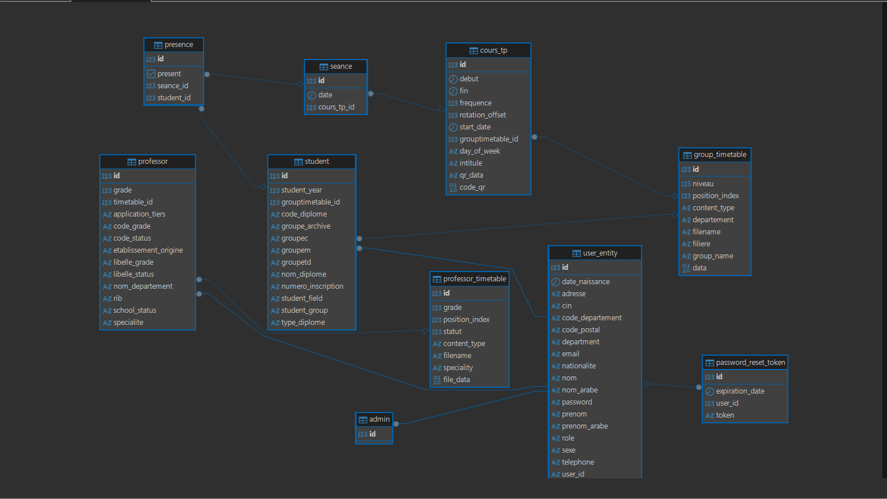

---

## Screenshots

### Authentication

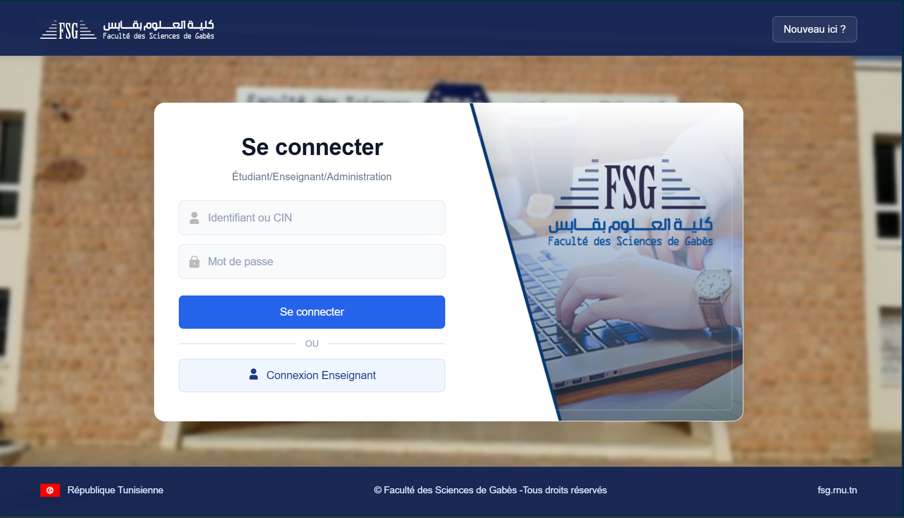

### Administration Dashboard

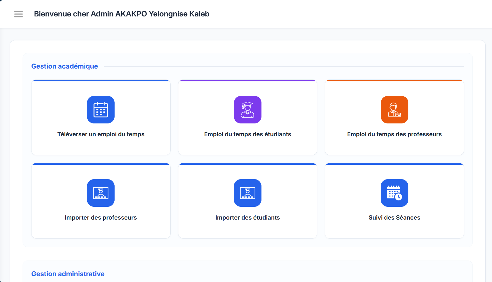

### Academic Timetables

#### Timetable Without Department Selection

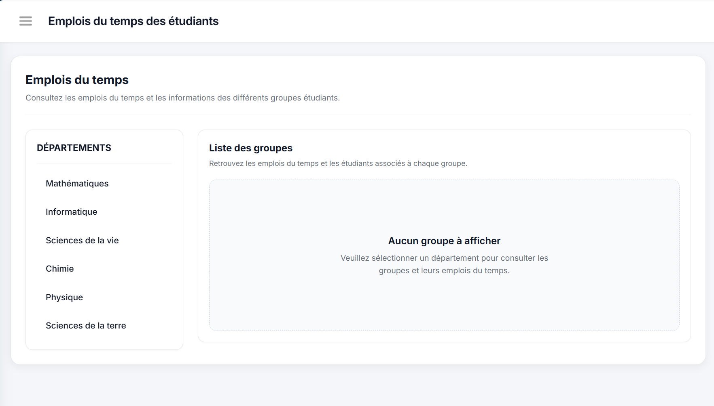

#### Timetable By Department

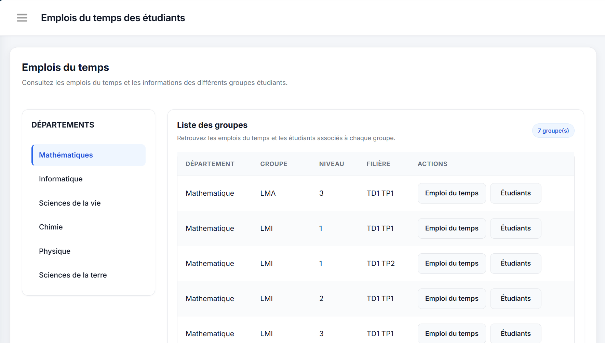

### Timetable Management

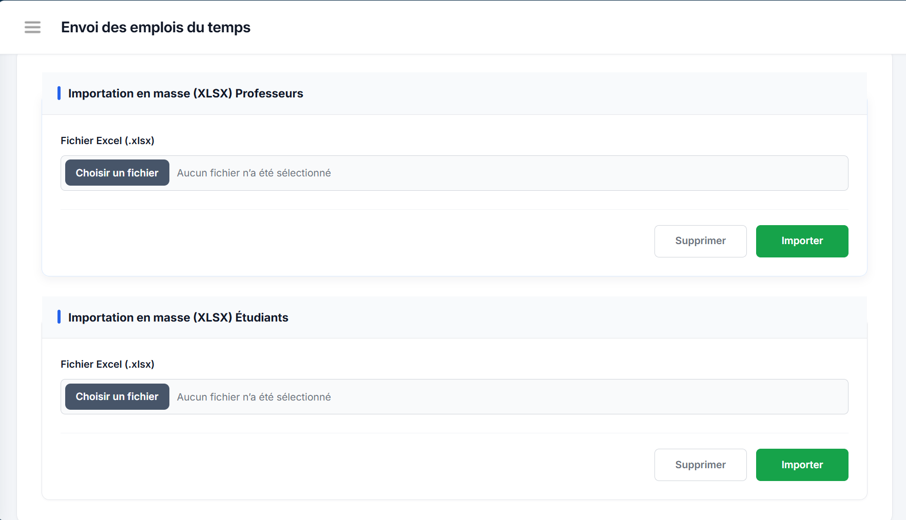

### Academic Field Management

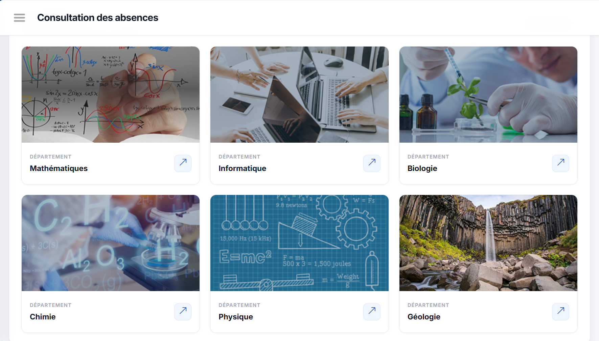

### Attendance Management

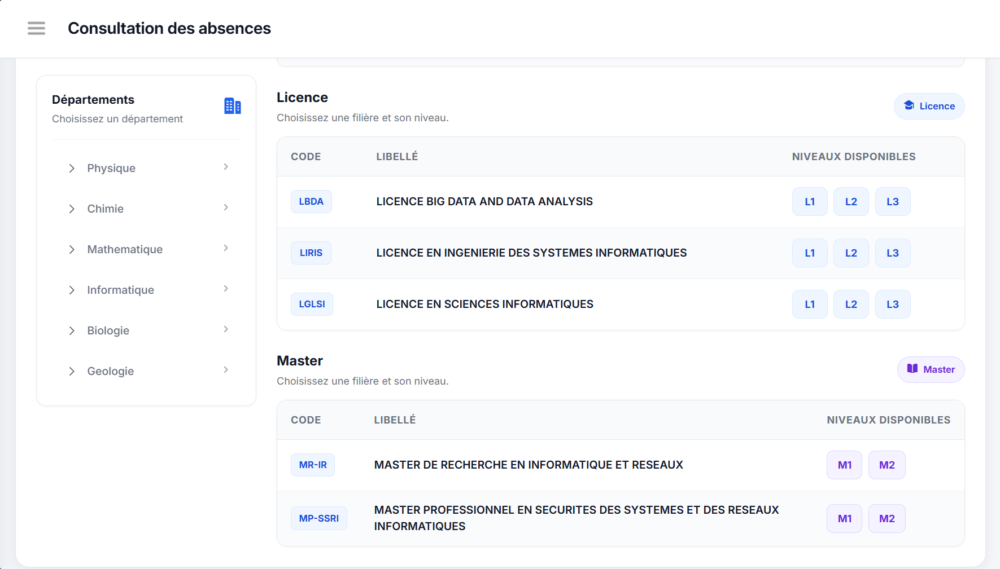

### Course Management

#### All Courses

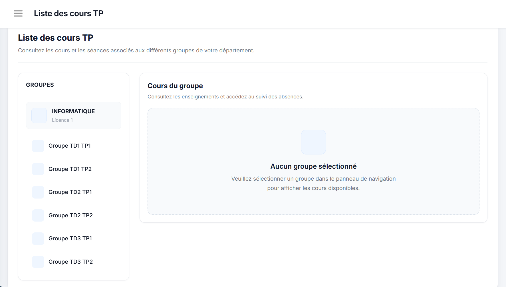

#### Courses By Academic Group

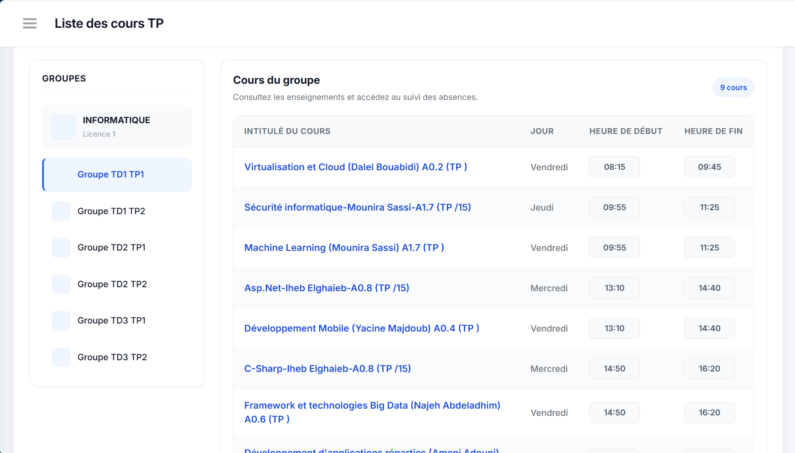

### Student Management

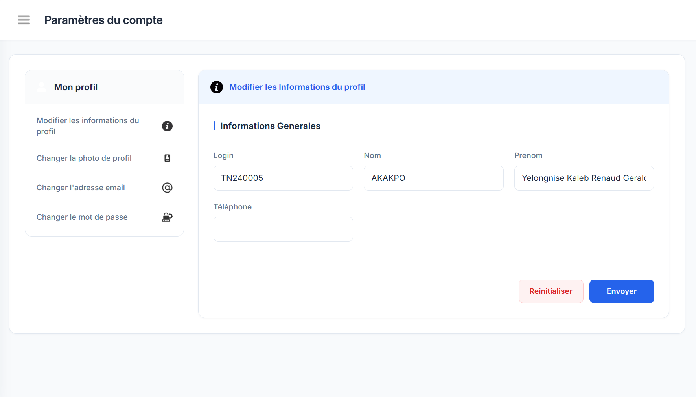

---

## Deployment

The application is designed to operate within a university's internal IT infrastructure.

It is deployed on a Windows Server environment and made accessible through the university's local network.

### Deployment Characteristics

- Windows Server deployment.
- HTTPS communication.
- Internal network accessibility.
- PostgreSQL database integration.
- Environment-based configuration.

The application is not currently publicly hosted on the Internet.

Its deployment is intended to provide access to authorized university users.

---

## Configuration

Sensitive application configuration is managed through environment variables.

### Environment Variables

| Variable | Description |
|----------|-------------|
| `DB_URL` | PostgreSQL JDBC connection URL |
| `DB_USERNAME` | Database username |
| `DB_PASSWORD` | Database password |

### PowerShell Configuration Example

```powershell
$env:DB_URL="jdbc:postgresql://localhost:5432/schedule_db"
$env:DB_USERNAME="postgres"
$env:DB_PASSWORD="your_password"
```

### application.properties

```properties
spring.datasource.url=${DB_URL}
spring.datasource.username=${DB_USERNAME}
spring.datasource.password=${DB_PASSWORD}
```

Additional application configuration may be required depending on the deployment environment.

---

## Installation

### Prerequisites

Make sure the following tools are installed:

- Java 17 or higher.
- PostgreSQL.
- Git.

Maven Wrapper is included in the repository.

### 1. Clone the Repository

```bash
git clone https://github.com/Belak17/ScheduleTimetable.git

cd ScheduleTimetable
```

### 2. Configure PostgreSQL

Create a PostgreSQL database:

```sql
CREATE DATABASE schedule_db;
```

Configure the database credentials using the environment variables described above.

### 3. Configure the Application

Set the required environment variables.

Make sure the database connection settings match your PostgreSQL configuration.

### 4. Run the Application

#### Windows

```powershell
.\mvnw.cmd spring-boot:run
```

#### Linux / macOS

```bash
./mvnw spring-boot:run
```

### 5. Access the Application

By default, open:

```text
http://localhost:8080
```

The actual address and port depend on the application configuration.

---

## Project Structure

Main application package:

```text
src/main/java/com/belak/scheduletimetable
│
├── configuration/
│
├── controller/
│
├── restcontroller/
│
├── service/
│
├── repository/
│
├── model/
│
├── dto/
│
├── request/
│
├── response/
│
├── enumeration/
│
├── exception/
│
├── security/
│
├── data/
│
└── record/
```

### Package Responsibilities

| Package | Responsibility |
|---------|----------------|
| `configuration` | Application configuration. |
| `controller` | MVC request handling. |
| `restcontroller` | REST API endpoints. |
| `service` | Business logic. |
| `repository` | Database access. |
| `model` | JPA entities. |
| `dto` | Data Transfer Objects. |
| `request` | Request models. |
| `response` | Response models. |
| `enumeration` | Application enumerations. |
| `exception` | Custom exception handling. |
| `security` | Authentication and authorization. |
| `data` | Data initialization and processing. |
| `record` | Java records. |

### Resources

```text
src/main/resources
│
├── templates/
│
├── static/
│   ├── css/
│   ├── js/
│   └── images/
│
└── application.properties
```

---

## Future Improvements

Potential future enhancements include:

- Attendance analytics and statistics dashboards.
- Automated daily academic session generation monitoring.
- Historical attendance tracking and reporting.
- PDF and Excel report generation.
- Email notifications.
- Advanced timetable update management.
- Improved mobile experience.
- Multi-language support.

---

## Maintenance and Development

The application is continuously maintained and improved.

Development activities include:

- Implementing new academic management features.
- Maintaining existing application functionality.
- Fixing bugs and improving reliability.
- Optimizing database operations.
- Improving application security.
- Adapting the system to evolving university requirements.

---

## Author

### Kaleb AKAKPO

**Software Engineering Student | Backend Developer**

Interested in backend engineering, Java development, data science, and machine learning.

#### Technologies

Java · Spring Boot · Spring Security · PostgreSQL · Hibernate · Python

#### GitHub

[github.com/Belak17](https://github.com/Belak17)

---

<p align="center">
  If you find this project interesting, consider giving it a ⭐!
</p>